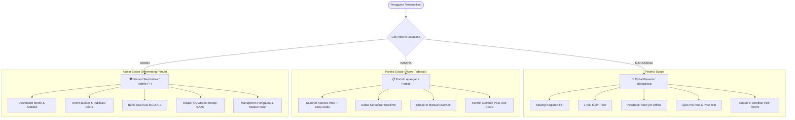
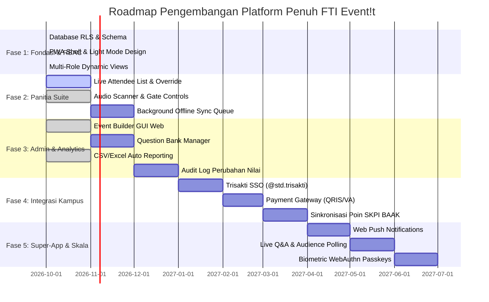

# 🚀 FTI Event!t — Master Enterprise Architecture & Full App Roadmap

> **Platform**: Progressive Web App (PWA) & Enterprise Campus Operations  
> **Institusi**: Fakultas Teknologi Informasi, Universitas Trisakti  
> **Arsitektur Teknis**: Next.js App Router (Turbopack) + Supabase Cloud (PostgreSQL 15+, Auth, Storage, Realtime) + Vercel Serverless Edge  
> **Penyusun**: `/agency-ux-architect` • `/agency-ui-designer` • `/agency-frontend-developer` • `/agency-backend-architect`  

---

## 1. Matriks Akses Peran Pengguna (Strict RBAC Specification)

Sistem membedakan secara tegas alur kerja (*Jobs to be Done*), tata letak antarmuka, dan otorisasi data untuk 3 entitas pengguna:

### Rincian Perbedaan Antarmuka (Persona Comparison)

| Dimensi | 📱 Peserta (Mahasiswa) | 📋 Panitia (Field Operations) | 🏛️ Admin (Pimpinan / BEM) |
| :--- | :--- | :--- | :--- |
| **Tujuan Utama** | Eksplorasi, tiket cepat, sertifikasi | Kecepatan pintu aula (<150ms), presensi lancar | Kebijakan, publikasi, rekap data |
| **Header Badge** | Profil Mahasiswa + NIM | `[PANITIA]` Emerald Pill Badge | `[KONSOL ADMIN]` Royal Blue Badge |
| **Navigasi Bawah** | Beranda, Event, Tiket, Sertifikat, Akun | Beranda, Scanner, Kehadiran, Kontrol, Akun | Beranda, Kelola Event, Scanner, Laporan, Akun |
| **Akses Rute** | `/events`, `/tickets`, `/test/*`, `/certificates` | `/panitia/scanner`, `/panitia/attendees`, `/panitia/control` | `/admin`, `/admin/events/*`, `/admin/reports`, `/admin/users` |
| **Proteksi URL** | Ditolak dari `/admin/*` & `/panitia/*` | Ditolak dari `/admin/*` | Akses penuh ke seluruh fitur sistem |

---

## 2. Lapisan Keamanan & Penegakan Izin (Multi-Layer Enforcement)

1. **Lapisan Database (Postgres RLS & Stored Procedures)**:
   - Fungsi `process_ticket_checkin` secara eksplisit memeriksa `profiles.role IN ('PANITIA', 'ADMIN')` sebelum mengubah status tiket menjadi `ATTENDED`. Mahasiswa yang mencoba memanggil RPC ini akan menerima kode error `403 FORBIDDEN`.
   - Kebijakan RLS membatasi modifikasi tabel `events` dan `event_questions` hanya untuk `ADMIN`.
2. **Lapisan Jaringan / Edge Middleware (`src/lib/supabase/middleware.ts`)**:
   - Rute `/admin/*` divalidasi di edge server: jika pengguna tidak terautentikasi atau bukan admin, request otomatis di-redirect ke `/unauthorized?required=ADMIN`.
   - Rute `/panitia/*` dan `/scanner` divalidasi di edge: jika pengguna berstatus `MAHASISWA`, request dialihkan ke `/unauthorized?required=PANITIA`.
3. **Lapisan Komponen UI**:
   - Komponen `BottomNav` mendeteksi sesi pengguna dan hanya merender tombol navigasi yang berhak diakses.
   - Halaman `/unauthorized` memberikan feedback yang jelas dan mengarahkan peserta kembali ke passbook tiket mereka.

---

## 3. Roadmap Aplikasi Penuh (Enterprise Campus Platform)

Roadmap ini memperluas cakupan dari sekadar MVP menjadi platform operasional kampus mandiri berskala penuh:

---

### Rincian Tiap Fase Roadmap

### 🟢 FASE 1: Fondasi, PWA, & Hardened Multi-Role RBAC (STATUS: SELESAI / CURRENT)
- **Tujuan**: Membangun fondasi arsitektur terpadu bebas dari AI slop dengan performa tinggi.
- **Pencapaian**:
  - Konversi penuh ke **Clean Academic Light Mode** (Latar putih, tipografi tegas, biru institusi `#1D4ED8`).
  - Implementasi RBAC terpisah untuk **Peserta**, **Panitia**, dan **Admin** di level database, middleware, dan navigasi bawah dinamis.
  - Halaman Profil dengan live role switcher untuk pengujian instan.
  - Passbook tiket QR offline dan generator PDF e-sertifikat resmi universitas.
  - Build produksi 20 rute lulus dengan nol error.

---

### 🟡 FASE 2: Panitia Operations Suite & Realtime Gate Control (Q4 2026)
- **Tujuan**: Menghadirkan kendali lapangan tanpa friksi bagi panitia saat ratusan peserta antre di pintu aula.
- **Fitur Utama**:
  1. **Check-In Manual Override**: Pencarian instan berdasarkan NIM / Nama untuk peserta yang baterai ponselnya habis atau layarnya retak.
  2. **Gembok Post-Test Terpusat**: Panitia membuka/menutup akses evaluasi dengan 1 tombol begitu pemaparan materi selesai.
  3. **Background Offline Sync Queue**: Penyimpanan scan tiket di IndexedDB browser saat sinyal auditorium kampus putus, dan otomatis disinkronkan saat terhubung kembali.
  4. **Live Audio Feedback**: Nada beep frekuensi tinggi (880Hz) untuk tiket valid dan frekuensi rendah (220Hz) untuk tiket ditolak.

---

### 🔵 FASE 3: Admin Governance, Question Bank, & Analytics Engine (Q1 2027)
- **Tujuan**: Memberikan pimpinan fakultas dan biro kemahasiswaan kendali penuh atas data dan penyelenggaraan acara.
- **Fitur Utama**:
  1. **Web Event Builder Form**: Publikasi kegiatan baru lengkap dengan kuota, kategori, jam mulai, dan lokasi tanpa menyentuh database manual.
  2. **Question Bank Manager**: Editor butir soal evaluasi (MCQ A–D) beserta pembobotan nilai otomatis.
  3. **Rekapitulasi CSV & Excel**: Ekspor data kehadiran dan skor ujian peserta terintegrasi untuk pelaporan resmi BAAK dan Dekanat.
  4. **Audit Logs & Verifikasi Sertifikat**: QR code pada sertifikat PDF yang jika dipindai akan membuka halaman publik `/verify/[certId]` untuk memvalidasi keaslian sertifikat fisik.

---

### 🟣 FASE 4: Integrasi Finansial & Kampus Universitas Trisakti (Q1–Q2 2027)
- **Tujuan**: Menghubungkan platform dengan ekosistem resmi universitas dan memfasilitasi kegiatan berbayar/nasional.
- **Fitur Utama**:
  1. **Trisakti Google SSO**: Login 1-klik menggunakan akun Google resmi `@std.trisakti.ac.id` dengan verifikasi NIM otomatis.
  2. **Payment Gateway (Midtrans / Xendit)**: Pembayaran tiket seminar berbayar via QRIS otomatis (Gopay, OVO, Dana, ShopeePay) dan Virtual Account bank nasional.
  3. **SKPI Credit Automation Engine**: Setelah formula angka kredit disahkan oleh senat akademik fakultas, poin kegiatan otomatis disinkronkan ke transkrip SKPI mahasiswa di SIAKAD.
  4. **Broadcast Pengumuman WhatsApp**: Integrasi WhatsApp Gateway (Fonnte / Twilio) untuk mengirimkan notifikasi H-1 acara dan link tiket langsung ke ponsel peserta.

---

### 🟠 FASE 5: Native PWA Super-App & Skala Lanjutan (Q2–Q3 2027)
- **Tujuan**: Mentransformasikan FTI Event!t menjadi platform interaktif real-time di panggung seminar.
- **Fitur Utama**:
  1. **Web Push Notifications**: Notifikasi pop-up langsung ke layar kunci ponsel peserta saat acara dimulai atau sertifikat siap diunduh.
  2. **Live Stage Q&A & Audience Polling**: Mahasiswa di kursi auditorium dapat mengajukan pertanyaan ke narasumber via ponsel dan melakukan vote (*upvote*) pertanyaan terbaik yang tampil di layar proyektor aula.
  3. **Biometric WebAuthn Passkeys**: Login sidik jari (Touch ID / Face ID) tanpa perlu mengingat kata sandi.
  4. **Read Replica & Multi-Region Database Scaling**: Optimasi koneksi database untuk kesiapan menangani 5.000+ mahasiswa saat pendaftaran hackathon akbar serentak dibuka.

---

## 4. Standar Kualitas Teknis & SLA

- **Latency Scanner**: < 150ms per pemindaian QR tiket.
- **Ketahanan Offline**: Tiket QR dan data profil harus dapat dibuka 100% tanpa jaringan internet (*Cache-First via Service Worker*).
- **Integritas Transaksi**: Mencegah *double check-in* dan *overbooking* kuota secara mutlak dengan isolasi level `FOR UPDATE` di PostgreSQL.
- **Aksesibilitas**: Memenuhi standar WCAG AA dengan rasio kontras teks minimal 4.5:1.
